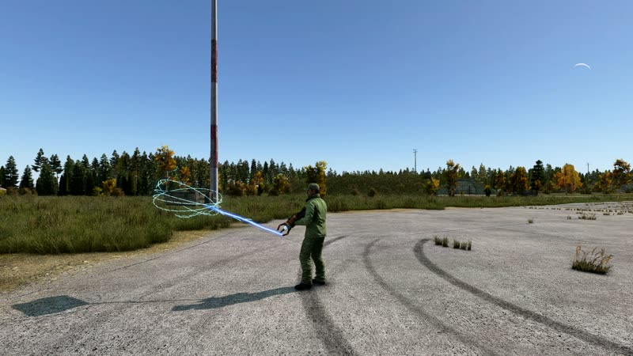
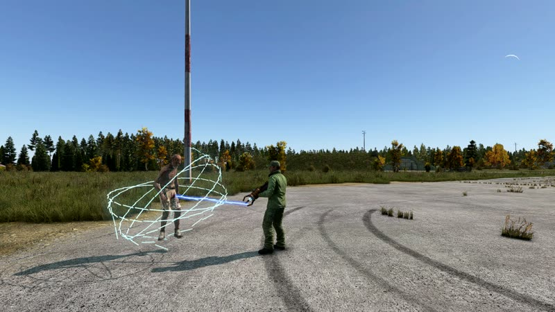
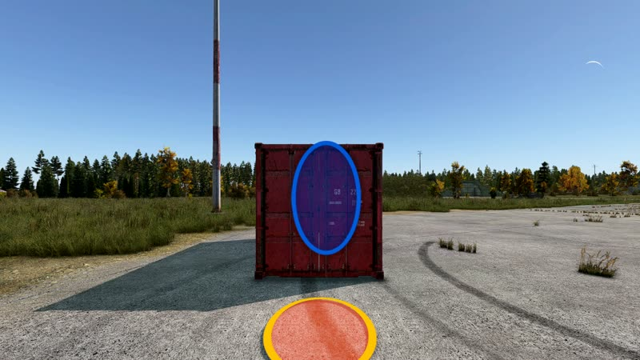
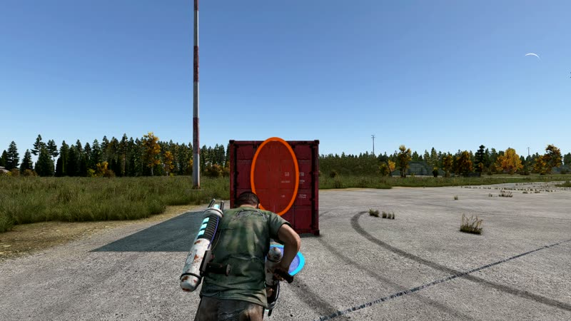

# PhysGuns

 [Hecho por Claude Code con el plugin `universal-modder`](https://github.com/rehan-remade/universal-modder)

[](https://github.com/rehan-remade/universal-modder)

[English](README.md) · [Русский](README-RU.md) · **Español** · [Português](README-PT.md)

<table>
<tr><td align="center"><a href="docs/screenshots/01_carry.jpg"></a><br><sub>Pistola de gravedad: lleva cualquier cosa suelta</sub></td><td align="center"><a href="docs/screenshots/02_infected.jpg"></a><br><sub>Infectados también</sub></td></tr>
<tr><td align="center"><a href="docs/screenshots/03_portals.jpg"></a><br><sub>Pistola de portales: uno en la pared y otro en el suelo</sub></td><td align="center"><a href="docs/screenshots/04_through.jpg"></a><br><sub>Entras por uno, sales por el otro</sub></td></tr>
</table>

Un mod de DayZ con dos armas: una **pistola de gravedad** al estilo de Half-Life 2 que agarra, lleva, lanza y empuja
cualquier cosa suelta, y una **pistola de portales** al estilo de Portal que enlaza dos portales por los que pasa
cualquier cosa conservando su velocidad. Las dos se empuñan como un AK sin culata, funcionan con seis pilas de 9V y
están pensadas para que los administradores las repartan: no forman parte del loot.

Mod de cliente + servidor `@PhysGuns`. Modelos, texturas, materiales y sonidos propios, todos generados por los
scripts de `tools/`, sin recursos de terceros.

## La pistola de gravedad (`PG_GravityGun`)

- **Empujón:** toque de disparo - lo que tenga delante (hasta 7 m) sale despedido: objetos, infectados, animales,
  jugadores e incluso vehículos (a un coche solo lo mueve un poco).
- **Agarrar y llevar:** mantén el disparo - atrapa lo que apunta, lo atrae desde hasta 12 m y lo sostiene delante de
  ti en una jaula chisporroteante mientras mantienes el gatillo; sigue tu mirada. Hasta 350 kg.
- **Lanzar:** recarga (o toque de disparo / botón secundario) mientras llevas algo.
- **Soltar:** suelta el disparo.
- **Criaturas:** infectados, animales y jugadores se pueden levantar y lanzar; si uno choca fuerte contra una pared o
  el suelo recibe daño como una caída a esa velocidad - un jugador queda inconsciente y puede romperse las piernas.
- **Efectos:** un rayo desde sus garras, un brillo, un zumbido que sube al balancear lo que lleva, y sus propios
  sonidos de agarre, soltar, empujón, lanzamiento y disparo en vacío.

## La pistola de portales (`PG_PortalGun`)

- **Dos portales, azul y naranja,** en cualquier superficie fija - suelo, paredes, rocas, edificios - hasta a 250 m; no
  en cosas que se mueven. Cada pistola tiene su par; un portal nuevo de un color sustituye al anterior.
- **Disparo** abre el portal del color elegido; el botón de **modo de disparo** (o **B**) cambia azul / naranja y la
  lámpara encendida de la pistola muestra cuál. El botón secundario (botón central del ratón, o aguantar la
  respiración al apuntar) siempre abre el naranja.
- **Recarga** cierra los dos portales.
- **Al apuntar** (arma levantada) se ve un contorno tenue donde se abrirá el portal.
- **Atravesar:** jugadores, infectados, animales y objetos que entran por uno salen por el otro, girados hacia donde
  mira y con la velocidad que traían - cae en un portal del suelo y saldrás volando de uno en la pared.
- **Sonido:** un disparo, un «whomp» al abrirse un portal y un zumbido estático grave alrededor de cada portal abierto.
- Un portal es un óvalo luminoso: el juego no puede mostrar la vista a través de él.

## Pilas

Cada pistola tiene seis ranuras de `9V Battery` y necesita las seis cargadas; si falta alguna o está agotada solo hace
clic y lo avisa. Un juego completo (6 × 50) da para unos 300 empujones, 200 lanzamientos, 20 minutos llevando cosas o
150 portales:

| acción | consume |
|---|---|
| empujón | 1 |
| lanzamiento | 1,5 |
| llevar / atraer | 0,25 por segundo (0,5 para empezar a agarrar) |
| un portal | 2 (solo si se abre) |

Una pistola creada con el debug spawn del juego - por ejemplo con el generador de objetos de Community Online Tools en
modo debug spawn - viene con seis pilas nuevas; creada de otra forma viene vacía.

## Estado

Las dos se desgastan como cualquier arma - prístina, desgastada, dañada, muy dañada, arruinada - con sus propias
texturas de daño: arañazos, óxido y hollín, y las lámparas que se atenúan y se apagan.

## Controles

| | teclado + ratón | mando |
|---|---|---|
| empujón / portal | disparo | disparo |
| agarrar y llevar | mantener disparo | mantener disparo |
| lanzar (gravedad) / cerrar portales | recarga | recarga |
| azul / naranja (portales) | B o modo de disparo | modo de disparo |
| secundario: lanzar / naranja | botón central | aguantar la respiración al apuntar |

El botón central y la B están en los controles del juego, en **PhysGuns**, y se pueden cambiar.

## Contenido

- `mod/PhysGuns` - el addon: config, scripts, modelos (MLOD `.p3d`), texturas (`.paa`), materiales (`.rvmat`),
  sonidos (`.ogg`) y las asignaciones de teclas. Empaquétalo en un pbo con el prefijo `PhysGuns` y fírmalo con tu clave.
- `mod/mod.cpp` - nombre y autor del mod, para la carpeta `@PhysGuns`.
- `tools/` - los generadores: `build_guns.py` (modelos, texturas y materiales de daño de las pistolas),
  `build_models.py` (portales, rayo), `build_sounds.py` (todos los sonidos, sintetizados), `build_pbo.py` (empaqueta el
  addon), `paa.py`.

## Servidor

1. Arma la carpeta `@PhysGuns` - `addons/physguns.pbo` (y su `.bisign`), `mod.cpp`, `keys/` con tu `.bikey` - ponla en
   la carpeta del servidor y cárgala en servidor y clientes (`-mod=...;@PhysGuns`).
2. Genera las pistolas como administrador: `PG_GravityGun`, `PG_PortalGun` (y `Battery9V` de repuesto). No están en
   `types.xml` y nunca aparecen como loot.

## Compilar

Python 3 con numpy y Pillow, `python-lzo` (para `paa.py`), `ffmpeg` con libvorbis (sonidos) y
[armake2](https://github.com/KoffeinFlummi/armake2) (compila los materiales):

```
python3 -I tools/build_models.py
python3 -I tools/build_guns.py
python3 -I tools/build_sounds.py
python3 -I tools/build_pbo.py mod/PhysGuns @PhysGuns/addons/physguns.pbo
```

## Límites conocidos

- Los cadáveres no se tocan: cuando un cuerpo se ha asentado, el servidor no puede moverlo de forma que los clientes lo
  vean.
- Un vehículo solo se puede empujar, y poco.
- Los modelos no tienen esqueleto, así que el juego registra un aviso inofensivo «Weapon has no skeleton».

## Licencia

Dominio público - [The Unlicense](LICENSE). Repacks, retexturas y modificaciones son bienvenidos. Los grabados están
dibujados con las fuentes DejaVu (licencia libre).

Hecho por Claude Code (Anthropic) con el plugin [universal-modder](https://github.com/rehan-remade/universal-modder),
probado en un servidor de pruebas y en Steam Deck.
